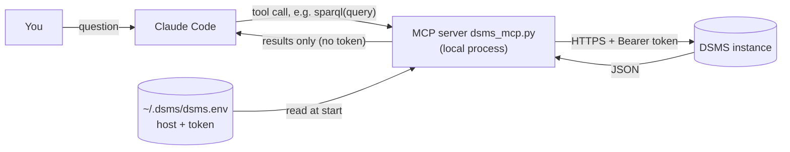

# DSMS for Claude Code, read-only and without handing the token to Claude

A [Claude Code](https://code.claude.com) plugin that lets you query a
[DSMS](https://github.com/MI-FraunhoferIWM/dsms-python-sdk) instance (Dataspace Management System,
`*.materials-data.space`) in the chat: K-Types, K-Items, attachments, SPARQL over the knowledge graph and the
ontology terms.

Two design goals:

1. **Claude never gets the token.** It is not in the prompt, not in a config file of the project and not in the
   environment of Claude Code. A small local MCP server reads it from a file in your home directory and only
   returns query results.
2. **Read-only.** There are no tools to create, change or delete anything. SPARQL accepts only `SELECT`, `ASK`,
   `CONSTRUCT` and `DESCRIBE`, and the only `POST` requests the server sends are the read-only search and SPARQL
   endpoints.

## How it works



Claude Code starts the MCP server as a child process (stdio). Claude sees the tool names, its own tool calls and the
results. The server builds the HTTP requests itself. Error messages pass on 401/403 and mask the token.

## Setup

### 1. Requirements

- Claude Code
- [uv](https://docs.astral.sh/uv/) on the `PATH` (`winget install astral-sh.uv`, `brew install uv` or
  `curl -LsSf https://astral.sh/uv/install.sh | sh`). uv fetches the Python packages of the server (`mcp`, `httpx`)
  on first start.
- Access to a DSMS instance (network access to the host and a token).

### 2. Put the credentials into a file, yourself

Create `~/.dsms/dsms.env` (Windows: `%USERPROFILE%\.dsms\dsms.env`) with an editor, not through Claude:

```
DSMS_HOST_URL=https://your-instance.materials-data.space/
DSMS_TOKEN=<token from the DSMS web interface>
```

You find the token in the DSMS web interface under your profile. It expires after some days, then you put the new
one into the same file. Another path can be set with the environment variable `DSMS_ENV` (the path, not the token).

Do not put the token into an environment variable of the shell you start Claude Code from, and not into the `env`
block of a Claude Code `settings.json`: processes started by Claude Code inherit that environment, so a plain `env`
in Claude's shell would show it. This is why the server reads only the file.

### 3. Install the plugin

In Claude Code:

```
/plugin marketplace add KorayIH/dsms-claude-code
/plugin install dsms-readonly@dsms-tools
```

Restart Claude Code and check with `/mcp` that the server `dsms` is connected. Update later with
`/plugin marketplace update dsms-tools`.

Without the plugin system you can register the server directly:

```
claude mcp add dsms --scope user -- uv run --quiet --script /path/to/dsms_mcp.py
```

### 4. Keep Claude's own tools away from the file

The MCP server is one way to the file. Claude Code also has its own file tools and a shell, both running as your OS
user. Add a deny rule to your **user** settings `~/.claude/settings.json` (Windows:
`%USERPROFILE%\.claude\settings.json`), see [`examples/settings.user.json`](examples/settings.user.json):

```json
{
  "permissions": {
    "deny": ["Read(~/.dsms/**)", "Edit(~/.dsms/**)"]
  }
}
```

Deny rules win over allow rules from any other settings file, so a project cannot loosen them. Check with
`/permissions`. For a team, put the same rules into managed settings.

## How far does this protection go?

Be precise about what each layer does:

| Layer | Stops | Does not stop |
|---|---|---|
| Token only in `~/.dsms/dsms.env`, read by the MCP server | the token ever being part of the prompt, the project or the tool results | Claude deliberately opening the file with its own tools |
| `permissions.deny` `Read(~/.dsms/**)` | Claude's built-in Read, Edit, Write, Grep and Glob tools, `@` mentions | a shell command such as `cat` or a Python one-liner: deny rules on Bash match command text and are not a security boundary |
| Sandbox: `sandbox.filesystem.denyRead` | shell commands too, enforced by the OS | runs on macOS, Linux and WSL2 only, not on native Windows |
| Remote MCP server with its own service account | the token being on your machine at all | needs a server and an auth layer in front of it |

In practice layers 1 and 2 mean the token is never shown to Claude in normal use, and Claude is told by the skill
never to read the credentials file. For a hard boundary against the shell as well, use one of the last two rows.

**Sandbox (macOS, Linux, WSL2).** [`examples/settings.sandbox.json`](examples/settings.sandbox.json) adds:

```json
{
  "sandbox": {
    "enabled": true,
    "filesystem": { "denyRead": ["~/.dsms"] }
  }
}
```

Sandboxed shell commands then cannot read the folder. The MCP server is started by Claude Code itself, not through
the sandboxed shell, so it still can. Details: [Claude Code sandboxing](https://code.claude.com/docs/en/sandboxing).

**Remote MCP server.** The same server can be run on a host that holds a service token and be reached over HTTP
(`claude mcp add --transport http ...`). Then put an authentication layer in front of it (Claude Code supports
OAuth and `headersHelper` for remote servers). This is not part of this repo.

## Scripts and notebooks with the Python SDK

When Claude writes scripts or Jupyter notebooks with the [dsms-sdk](https://pypi.org/project/dsms-sdk/), the same
idea applies: the script loads the credentials file inside its own process at run time, Claude only writes the code
and sees what it prints. The SDK stores the token as a pydantic `SecretStr`. See
[`examples/sdk_example.py`](examples/sdk_example.py):

```python
from pathlib import Path
from dsms import DSMS

dsms = DSMS(env=str(Path.home() / ".dsms" / "dsms.env"))
rows = dsms.sparql_interface.query("SELECT ?class (COUNT(?s) AS ?n) WHERE { ?s a ?class } GROUP BY ?class")
```

Note that the shell layer from the table above applies here as well: the script runs as your user.

## Tools

| Tool | Purpose |
|---|---|
| `list_ktypes` | which kinds of items exist |
| `read_ktype` | fields of a K-Type with widget, unit, term (IRI) and link target |
| `list_kitems` | items, optionally of one K-Type |
| `search_kitems` | full-text search |
| `read_kitem` | all fields, links and attachments of an item |
| `read_attachment` | CSV and text directly, images and PDF saved to a temp folder |
| `sparql` | read-only SPARQL over the graph (`SELECT`, `ASK`, `CONSTRUCT`, `DESCRIBE`) |
| `search_terms` | terms of the loaded ontologies |

The skill `dsms-query` tells Claude how to use them (check the structure first, SPARQL for evaluations, values with
unit and source item) and sets the rules: no personal data of people in the output, no DSMS data to external
services, never ask for the token.

Example questions:

- "Which K-Types are there?"
- "Show me all items of K-Type X with field Y above 100."
- "Which item classes have the most entries? Use SPARQL."

## Files

| File | Content |
|---|---|
| `.claude-plugin/marketplace.json` | marketplace `dsms-tools` with one plugin |
| `plugins/dsms-readonly/.mcp.json` | starts the MCP server with uv |
| `plugins/dsms-readonly/server/dsms_mcp.py` | the MCP server, read-only tools, single file with inline dependencies |
| `plugins/dsms-readonly/skills/dsms-query/SKILL.md` | instructions for Claude |
| `examples/dsms.env.example` | template for the credentials file |
| `examples/settings.user.json` | deny rules for Claude's file tools |
| `examples/settings.sandbox.json` | deny rules plus sandbox (macOS, Linux, WSL2) |
| `examples/sdk_example.py` | SDK script that loads the token without Claude seeing it |

## Disclaimer

Not an official product of the DSMS developers or of Anthropic. The REST endpoints used are those of the DSMS web
API as of 2026 and may change. MIT license.
